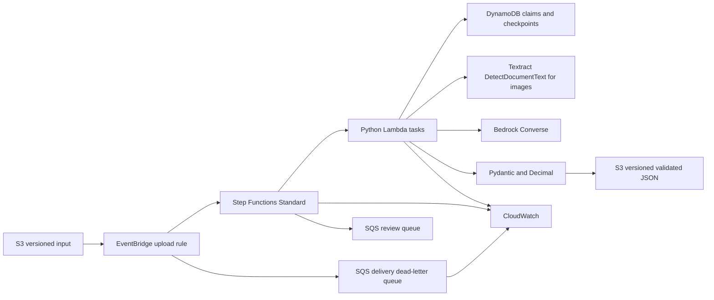

# Architecture

The rule matches native S3 Object Created events for `incoming/` on the designated input bucket. The pipeline reads each exact S3 object version. It accepts nonempty UTF-8 text up to 12,000 bytes and PNG/JPEG up to 5 MB, checks extension, content type, content encoding and image signature, and limits OCR text sent to the model. The model copies source fields as JSON. A versioned prompt directs it to preserve inconsistent values. Pydantic enforces an exact schema. Decimal arithmetic checks cent precision, line amounts rounded half-up, subtotal and total. Currency is limited to USD, EUR, GBP, INR, CAD and AUD. The pipeline can normalize receipts with explicit receipt identifiers to the invoice-shaped output.

## Delivery and concurrency

The document ID is SHA-256 of original bytes. Two versions or keys with identical bytes share a claim. A conditional put assigns one execution owner per content hash, and subsequent writes check owner and status. An in-flight duplicate exits with `DUPLICATE_IN_PROGRESS`. Completed and rejected duplicates return `DUPLICATE_ACCEPTED` or `DUPLICATE_REVIEW`. The original execution owns processing. If its lease expires, an operator may explicitly reprocess the same object version. The 15-minute lease exceeds the 7-minute Step Functions deadline and Lambda timeout. Input rejects, where no content claim exists, use a separate `review#` record keyed by source version.

The durable states are `PROCESSING` → `READY` → `ACCEPTED`, with terminal failures routed to `REVIEW_REQUIRED`. READY stores the exact bounded JSON candidate. S3 uses an atomic conditional write to `validated/<sha256>.json`. If a write succeeded before its response or subsequent DynamoDB commit was lost, retry verifies the candidate hash in S3 metadata and reconciles the DynamoDB state. Treat DynamoDB ACCEPTED as the commit marker for consumers. The S3 object can be visible briefly before that marker. Restrict output writes and never remove accepted objects independently of the table. Bedrock and Textract calls can repeat if a transient error interrupts work before the candidate checkpoint; accepted output still uses one key and one write.

Known limits include byte-identical deduplication only, billed OCR and LLM retries, possible model transcription errors that satisfy arithmetic, single-page raster OCR, and an operator-managed review workflow. A scanned-PDF extension would use asynchronous Textract StartDocumentTextDetection with notification/polling, collect all paginated results, apply page/token limits, and keep raw OCR out of Step Functions payloads. The current intake rejects PDFs.
