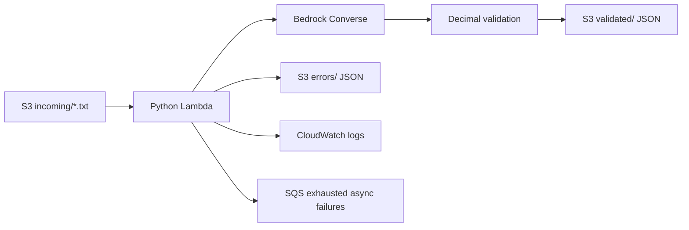

# Architecture

Separate buckets prevent recursion. Versioned input allows reading the exact event
version. Keys are URL-decoded; reads are bounded to 100,000 bytes. Input must be
nonempty UTF-8 plain text. Instructions treat document content as untrusted;
prompt injection and plausible model errors remain possible.

A SHA-256 trace ID identifies bucket, key, version and event sequencer. Output
includes source references, schema version, trace ID and invocation request ID.
Errors/logs include stage and exception class, excluding document/model content
and exception messages. Error objects retain per-request attempts. Financial
outputs still require restricted access.

Malformed documents and invalid invoices terminate with recorded errors. Model,
JSON and infrastructure failures propagate for Lambda async retries (two retries,
one-hour event age). Error-write failures propagate immediately. Exhausted events
go to encrypted SQS (14-day retention). Operators inspect/replay after remediation.
CloudWatch logs retain 14 days; no alarm/on-call integration is provisioned.

S3 delivery is at least once. Duplicate events reuse output keys but can invoke
Bedrock repeatedly, incur charges and overwrite extraction results. There is no
exactly-once or atomic transaction guarantee. Old errors remain after success;
trace IDs correlate outcomes. Multi-record retries can reprocess successful items.

SAM provisions encrypted private buckets, scoped IAM, Lambda, S3 notification,
logs and a failure queue. The input bucket name is deterministic to avoid a SAM
S3/IAM dependency cycle. Bedrock IAM permits one regional foundation model;
cross-region inference profiles require separate configuration. Buckets are
retained on deletion to prevent accidental data loss.
